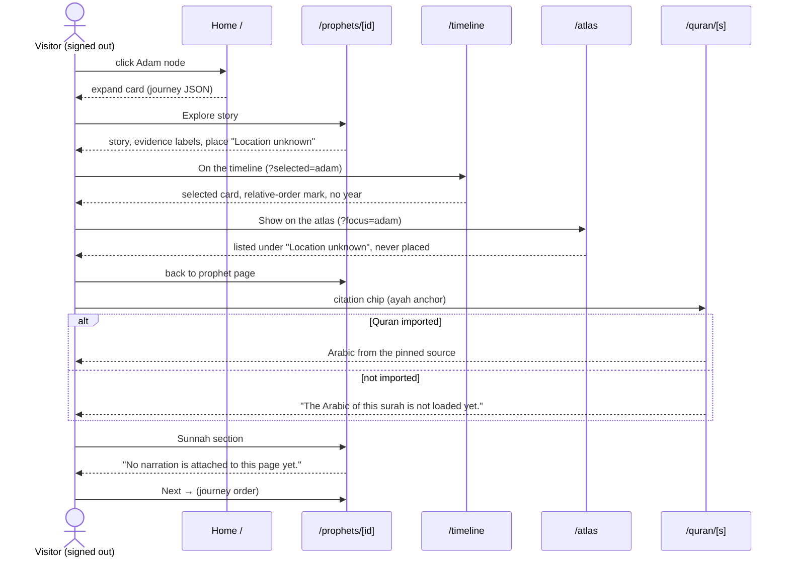
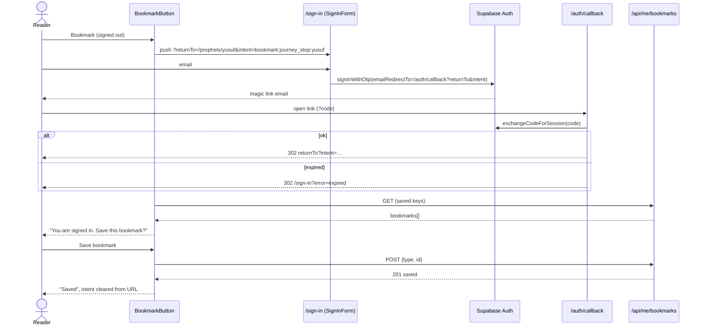
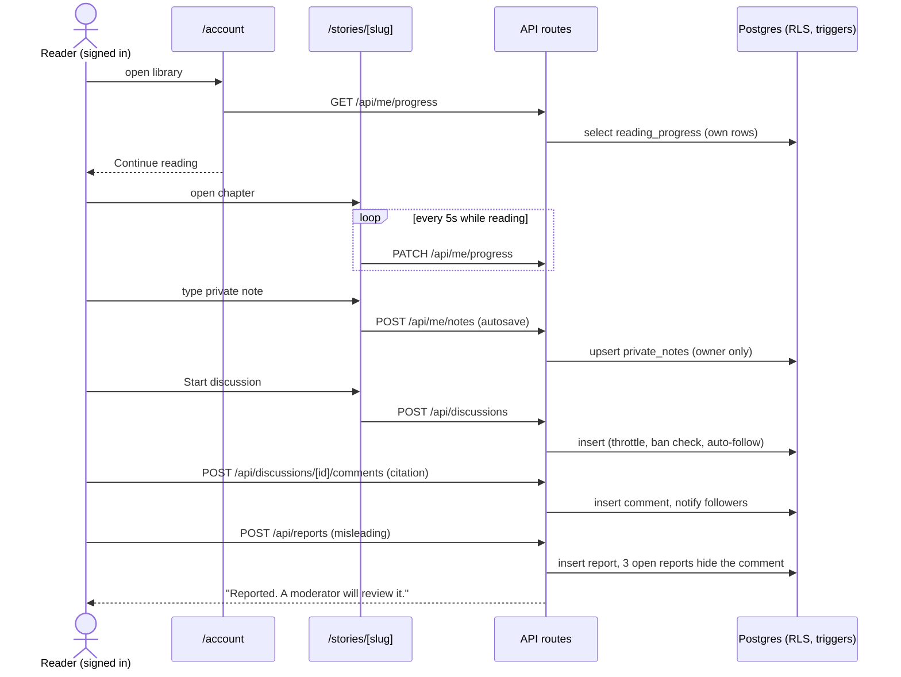
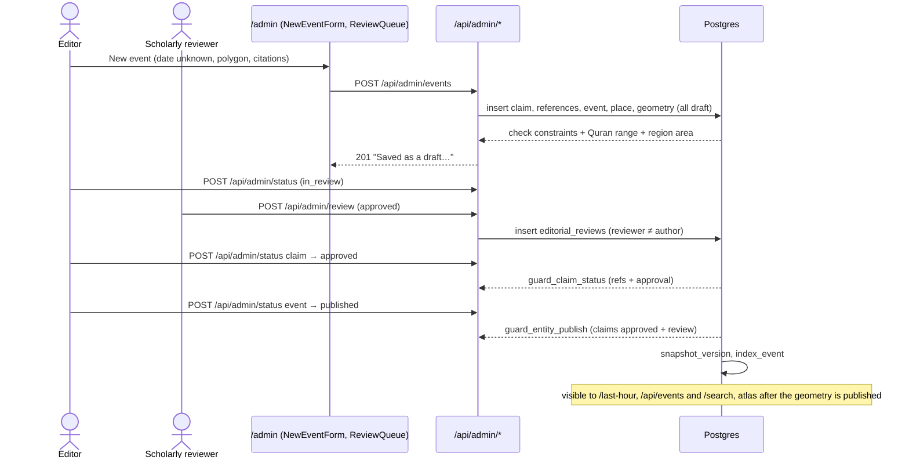
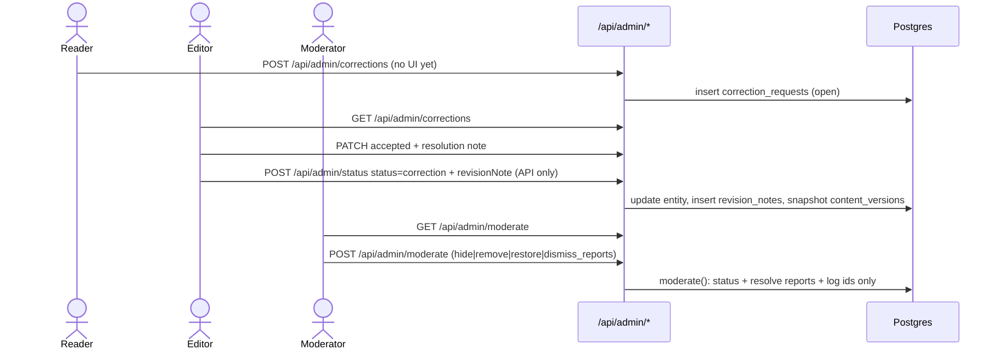
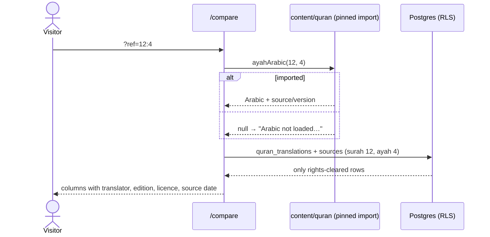

# Interaction flows

The six mandatory flows from `PROMPT_1_DESIGN_UX.md` (A–F), written against the real implementation. Each flow has a numbered step table (screen, user action, system response, route or API, state change, failure path) and a mermaid sequence diagram. Where the code cannot yet complete a step, the table says so; nothing here is described as working when the code shows an unavailable state.

Configuration assumed per flow:

| Flow | Needs |
|---|---|
| A | Nothing beyond the repository. The Quran step shows Arabic only after the verified import; the atlas step uses the place list (the map needs tiles). |
| B | Supabase (Auth). Without it the Bookmark button is disabled with "Accounts coming soon" (tested). |
| C | Supabase, a signed-in reader, and at least one published story for "resume". |
| D | Supabase, an editor account and a different scholarly-reviewer account. |
| E | Supabase, an editor and a moderator (or an admin). |
| F | The Quran import for the Arabic column; Supabase plus rights-cleared translation sources for the other columns. |

---

## Flow A: anonymous visitor follows Adam through the evidence

Adam (عليه السلام) → timeline event → mapped location or unknown zone → Quran verse → matching hadith → next related prophet, without signing in. Covered end to end by `tests/e2e/pages.spec.ts` ("flow A").

| # | Screen | User action | System response | Route / API | State change | Failure path |
|---|---|---|---|---|---|---|
| 1 | Home `/` | Clicks the Adam node | Adam's card expands, node pulses, progress line fills; scroll-sync holds 1.2s | — | `active = "adam"` | None (static) |
| 2 | Home | Clicks "Explore story" | Navigates | `/prophets/adam` | — | — |
| 3 | Prophet page | Reads the head: chapter position, era tag "Chronological position", evidence labels, place label | — | — | — | Draft badge stays visible while the journey is unreviewed |
| 4 | Prophet page | Clicks "On the timeline" (On the journey card) | Timeline renders with Adam selected and its card on the right (below on mobile) | `/timeline?selected=adam` | `aria-current` on Adam's item | Unknown `selected` → "Select a stop on the timeline." |
| 5 | Timeline | Clicks "Show on the atlas" | Atlas place list marks Adam (bold, `aria-current`) under "Location unknown"; no pin is drawn | `/atlas?focus=adam` | — | Map area shows "The interactive map is not connected yet." without tiles; the list still works |
| 6 | Atlas | Clicks "Adam" in the list | Returns to the prophet page at Places | `/prophets/adam#places` | — | — |
| 7 | Prophet page, Story | Clicks the first story citation chip (for Adam the journey data gives `Q 2:30–39`) | Opens the surah at the first ayah | `/quran/2#ayah-30` | — | Without the import: "The Arabic of this surah is not loaded yet." |
| 8 | Prophet page, Sunnah | Opens `#hadith` | Designed empty state | `/prophets/adam#hadith` | — | Always today: "No narration is attached to this page yet." (no unverified narration is shown) |
| 9 | Prophet page | Clicks "Next →" in the position bar | Next stop in journey order | `/prophets/idris` | — | — |

---

## Flow B: anonymous bookmark, optional sign-in, return and confirm

| # | Screen | User action | System response | Route / API | State change | Failure path |
|---|---|---|---|---|---|---|
| 1 | Any page with `BookmarkButton` (prophet head, verse card, ayah row, hadith card, story head) | Clicks "Bookmark" while signed out | Navigates to sign-in carrying where they were and what they wanted | `/sign-in?returnTo=<path+query>&intent=bookmark:<type>:<id>` | — | Supabase not configured: button is disabled with "Accounts coming soon"; nothing navigates |
| 2 | Sign in | Reads the banner "After you sign in you will return to the page and be asked to confirm saving the bookmark." and enters an email | "Sending" (`aria-busy`) | Supabase `auth.signInWithOtp` with `emailRedirectTo=/auth/callback?returnTo&intent` | — | 429 → "Too many requests. Wait a minute and try again."; other → "We could not send the link. Check the address and try again." |
| 3 | Sign in | — | "Check your email" + "We sent a sign-in link to [email]. It works once and expires soon. You can close this tab." | — | — | — |
| 4 | Email | Opens the magic link | Server exchanges the code for a session cookie and redirects | `GET /auth/callback?code&returnTo&intent` → 302 to `returnTo?intent=…` | Session cookie set | Expired or reused link → `/sign-in?error=expired` ("That sign-in link has expired or was already used. Request a new one."); missing code or no Supabase → `/sign-in?error=callback` |
| 5 | Original page | — | `useSession` resolves `signed_in`; `BookmarkButton` loads saved keys once per page; the intent matches and the item is not saved, so it asks: "You are signed in. Save this bookmark?" with "Save bookmark" and "Not now" | `GET /api/me/bookmarks` | `confirming = true` | Load failure leaves the button disabled (state unknown) |
| 6 | Original page | Clicks "Save bookmark" | Optimistic "Saved" (`aria-pressed=true`, filled icon); `intent` removed from the URL without scrolling | `POST /api/me/bookmarks {type, id}` (idempotent upsert, 201) | Row in `bookmarks` | 401 → rollback + "Your session ended. Sign in again."; other → rollback + "Could not save. Try again." (`role="alert"`) |
| 6b | Original page | Clicks "Not now" | Prompt closes; `intent` removed | — | Nothing saved | — |

Notes:

- `returnTo` passes `safeReturnTo()`: only a same-origin path survives; anything else becomes `/`. The locale prefix is stripped before it is stored.
- Only bookmark intents exist (`Intent` in `src/lib/validation.ts`). Note and discussion sign-in links carry `returnTo` only; the reader repeats the action after returning.
- If the item was already saved, no prompt appears and the `intent` parameter stays in the URL.

---

## Flow C: resume, private note, moderated discussion, report

| # | Screen | User action | System response | Route / API | State change | Failure path |
|---|---|---|---|---|---|---|
| 1 | My library | Opens `/account` | Lists bookmarks, progress and notes; shows "Continue reading" for the most recent unfinished chapter | `GET /api/me/bookmarks`, `/api/me/progress`, `/api/me/notes` | — | Signed out → redirect `/sign-in?returnTo=/account`; partial failure → "Some of your library could not be loaded. Refresh to try again." |
| 2 | My library | Clicks "Continue reading: [story]: [chapter] (n%)" | Opens the chapter | `/stories/[slug]?chapter=n` | — | No published story → no resume card |
| 3 | Story reader | Scrolls | Progress measured from the article; sent at most every 5s and on hide; "Progress saved: n%" | `PATCH /api/me/progress {chapterId, percent}` | `reading_progress` only moves forward; ≥100 sets `completed_at` | Network error retries on the next tick |
| 4 | Story reader, side column | Types in "Private note" | Autosave 1s after typing stops and on blur; "Saving…" → "Saved. Only you can read this note."; leaving with unsaved text triggers the browser warning | `POST /api/me/notes {target: {type: "chapter", id}, body}` | Upsert in `private_notes` (owner-only RLS, never logged) | "Not saved. Your text is still here." + Retry |
| 5 | Story reader, Discussion | Types a title (≥4 characters) and clicks "Start discussion", or opens an existing thread | Thread created; author auto-follows; navigates | `POST /api/discussions {contentType, contentId, title}` → `/community/[id]` | `discussions`, `discussion_follows` | Throttle (2 a minute, 10 an hour) → "Too many requests. Try again in a minute."; banned → "posting is suspended for this account" |
| 6 | Thread | Writes a comment, optionally "Cite a verse or narration" (`Q 12:3` or `Bukhari 1`), clicks "Post comment" | Toast "Posted."; the citation renders as a chip "Cites …" | `POST /api/discussions/[id]/comments {body, citation?, parentId?}` | `comments`; followers notified (`notifications`) | Bad citation pattern blocked by the field; throttle 5 a minute, 60 an hour; locked thread → form hidden |
| 7 | Thread | Clicks "Report" on another reader's comment | Inline form: reason (radio) + optional details | — | — | Own comments show Delete instead |
| 8 | Thread | Chooses "Misleading about the sources", clicks "Send report" | Toast "Reported. A moderator will review it." | `POST /api/reports {targetType: "comment", targetId, reason, details?}` | `reports` (one per reader per item); at 3 open reports the comment becomes `hidden` ("Hidden while a moderator reviews a report.") | Duplicate → 200 `{duplicate: true}`, same toast; throttle 5 a minute, 30 an hour |
| 9 | Moderation (staff) | Moderator decides (see flow E) | — | `POST /api/admin/moderate` | — | — |

Gap against the brief: discussions attach to a page or item (`content_type` + id), not to a single evidence card. `DiscussionInput` accepts an optional `claimId` and `VerseCard`/`HadithCard` accept a `discussHref`, but no screen passes either yet.

---

## Flow D: editor creates an event with an unknown date, through review, to publication

"No evidence, no publish" is enforced by database triggers, not only by the UI.

| # | Screen | User action | System response | Route / API | State change | Failure path |
|---|---|---|---|---|---|---|
| 1 | `/admin/events/new` | Fills slug, title, Arabic title, summary, category; Date precision "Unknown — no date" (or "Relative order only — no years" with a relative order) | Form validated in the browser (patterns, required) | — | — | Non-editor never sees the form (layout gate) |
| 2 | Same | Writes the claim sentence, picks the evidence kind, enters references one per line (`Q surah:ayah[–ayah]`, or `kind \| source id \| locator`) | — | — | — | — |
| 3 | Same | Picks a location, certainty "Approximate region (polygon)" or "Historical hypothesis (polygon)", types polygon corners as "longitude latitude" lines, picks a source | Ring is closed automatically | — | — | Region without polygon or source → 422 "an approximate region needs a polygon and a source; otherwise mark the place unknown" |
| 4 | Same | Clicks "Save draft" | "Saved as a draft. Ask a scholarly reviewer to approve the claim and the event, then publish." | `POST /api/admin/events` | Inserts `evidence_claims` (draft), `claim_references`, `historical_events` (draft), `event_places`, `place_geometries` (draft) | Check constraints: a year on a relative or unknown date, a relative date without order, any date on a Last Hour sign, or a dated sacred-history event are refused (422 with the rule); Quran range outside the surah refused; region smaller than the minimum area for its location type refused; a failure part-way leaves drafts only |
| 5 | `/admin/review` | Editor clicks "Send for review" on the claim and on the event | "Sent for review." | `POST /api/admin/status {entityType, entityId, status: "in_review"}` | `status = in_review` | — |
| 6 | `/admin/review` | A scholarly reviewer (not the claim's author) clicks "Approve", or "Request changes" with a comment | "Approved." / "Changes requested." | `POST /api/admin/review {entityType, entityId, decision, comment?}` | Row in `editorial_reviews` (audited) | Non-reviewer → 403; reviewing one's own claim → "a reviewer cannot approve their own claim" |
| 7 | `/admin/review` | Editor clicks "Mark claim approved" | "Claim approved for use." | `POST /api/admin/status {entityType: "claim", status: "approved"}` | `guard_claim_status()`: needs ≥1 reference and the latest review approved | "claim … has no references" / "claim … lacks a scholarly approval" (422) |
| 8 | `/admin/review` | Editor clicks "Publish" on the event | "Published." | `POST /api/admin/status {entityType: "event", status: "published"}` | `guard_entity_publish()`: ≥1 claim, all approved, latest review of the event approved; `snapshot_version()` writes `content_versions`; `index_event()` updates `search_index` | "event … has N unapproved claim(s)" / "lacks a scholarly approval" (422) |
| 9 | Public views | Readers open the views | See below | — | — | — |

Where the published event appears today:

| View | Reads | Status |
|---|---|---|
| `/last-hour` | `historical_events` in the two Last Hour categories, ordered by `relative_order`, "Date: none is known." | Shows it when the category is a Last Hour sign |
| `/api/events` | Published events with precision, people, places | Shows it |
| `/search` | `search()` RPC over `search_index` | Shows it |
| `/atlas` map | `atlas_places()` → published `place_geometries` | Only after the geometry itself is reviewed and published (step not available in the review queue UI, which does not list `place_geometries`; the API accepts `entityType: "place_geometry"`), and only with map tiles configured |
| `/timeline` | The journey JSON only | Does not show database events yet |
| Story | `chapter_claims` of published chapters | Shows the claim if an editor links it to a chapter in `/admin/stories` |
| Genealogy graph | `relationships` | Separate entity; an event does not create edges |

---

## Flow E: admin reviews a correction, updates a claim with a revision note, moderates a report

| # | Screen | User action | System response | Route / API | State change | Failure path |
|---|---|---|---|---|---|---|
| 1 | (reader) | Submits a correction | Stored as open | `POST /api/admin/corrections {entityType, entityId, body, evidence?}` (any signed-in reader) | `correction_requests` `open` | No public screen calls this endpoint yet; the corrections page tells readers to use "Report an error" (not built) or the contact page |
| 2 | `/admin/corrections` | Editor reads the request (entity, body, "Evidence offered") | — | `GET /api/admin/corrections` | — | Load error → "Could not load: …" |
| 3 | Same | Clicks "Accept" and writes a resolution note (browser prompt) | "Accepted. Correct the content from the review queue with a public revision note." | `PATCH /api/admin/corrections {id, status: "accepted", resolutionNote}` | `resolved_by`, `resolved_at` | Empty note cancels; Reject and Duplicate work the same way |
| 4 | `/admin/review` | Editor moves the claim or entity to "correction" with a public revision note | Entity updated; revision note stored | `POST /api/admin/status {entityType, entityId, status: "correction", revisionNote}` | `revision_notes` (`is_correction`, `public`); `content_versions` snapshot | No note → 422 "A correction needs a public revision note." **The review queue UI has no control that sends this request or edits claim text yet; the step is API-only.** |
| 5 | Public page | Reader looks for "Corrected on …" | — | — | — | **No public screen reads `revision_notes` yet**; the footer line "Every page has a revision history" has nothing to link to |
| 6 | `/admin/review` | Editor opens "History" on an item | Table of fields changed between the two latest versions (`<del>`/`<ins>`) | `content_versions` (browser client) | — | "No published versions yet." / "Only version N exists." |
| 7 | `/admin/moderation` | Moderator reads open reports (oldest first): reason, time, the comment body (moderators see hidden bodies), reporter's note | — | `GET /api/admin/moderate` + `comments_public` | — | "No open reports." |
| 8 | Same | Clicks Hide, Remove, Restore or Dismiss reports | "Done: hide." etc.; the queue reloads | `POST /api/admin/moderate {targetType, targetId, action, reason}` → `moderate()` RPC | One transaction: comment or thread status, reports `actioned` or `dismissed`, `moderation_actions` row with ids and reason only | Non-moderator → 403 "moderators only" |
| 9 | Thread | Readers see the outcome | Hidden: "Hidden while a moderator reviews a report."; removed: "Removed by a moderator for breaking the discussion guidelines."; the comment keeps its place | — | — | Appeals table exists; no appeal screen yet |

---

## Flow F: compare translations or scholarly readings

| # | Screen | User action | System response | Route / API | State change | Failure path |
|---|---|---|---|---|---|---|
| 1 | `/compare` | Opens the page (no link in the navigation yet; reached by URL or sitemap) | Defaults to `ref=1:1` | `/compare` | — | — |
| 2 | Same | Types an ayah reference (`12:4`) and clicks "Compare" | GET form | `/compare?ref=12:4` | — | Invalid → "That is not an ayah reference." + "Write it as surah:ayah, for example 12:4." |
| 3 | Same | Reads the Arabic column | Arabic from the pinned import with "source, version"; Quran evidence label and chip | `ayahArabic()` | — | Not imported → "Arabic not loaded — the verified source has not been imported yet." |
| 4 | Same | Reads translation columns | One card per licensed translation: language eyebrow, translator, text, Edition, Licence, Source recorded (date) | `quran_translations` + `sources`, filtered by RLS `source_publishable()` (rights `cleared` or `public_domain`) | — | None cleared or no Supabase → "Licence pending", "No translation is licensed for display yet." + link to the licence register |
| 5 | Hadith narration | Compares gradings | Every grading with grader and source; "Graded differently by other scholars"; "Scholars differ on this narration" panel | `/hadith/[c]/[n]` | — | Not published → designed empty state |
| 6 | (scholarly readings) | Wants to compare tafsir | — | — | — | **Not built.** The surah page shows "No tafsir is attached to this surah yet."; the compare empty state says tafsir will work the same way |

The same ayah is also available as JSON at `GET /api/quran/[surah]/[ayah]` (Arabic, source name, version, licence, URL, cleared translations).

